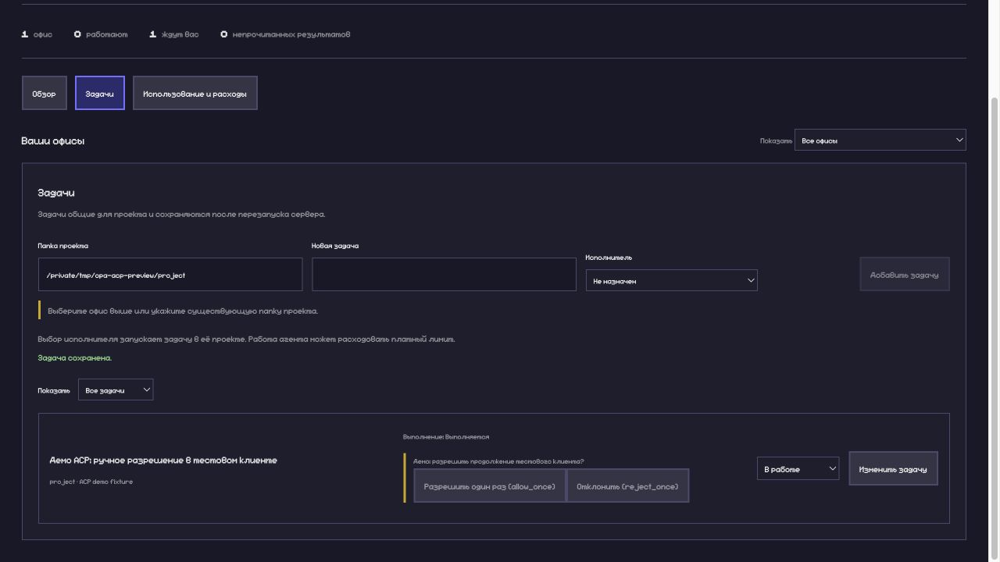

# OPA adapters

OPA is a visualization and local control client, not a scheduler. A transport must not choose the next task, approve a request, merge work or silently resume a paid run. Saving a task or assignment is passive. Only a separate explicit Start command can launch one task; queue pause/resume never dispatches. See [Task Queue and API migration](TASK_QUEUE.md).

## Implemented surfaces

| Adapter                         | Discovery                             | Events → OPA                                         | Commands → agent                                                        | Fallback                                                         |
| ------------------------------- | ------------------------------------- | ---------------------------------------------------- | ----------------------------------------------------------------------- | ---------------------------------------------------------------- |
| Codex native JSONL              | PATH + successful `--version`         | Existing `exec --json` normalizer                    | Prompt via stdin; cancel process group                                  | Existing external bridge/replay                                  |
| OpenCode native JSONL           | PATH + successful `--version`         | Separate run-JSON adapter; existing plugin unchanged | `run --format json`; cancel process group                               | Existing plugin/bridge/replay                                    |
| Claude legacy                   | Explicit observer descriptor          | Existing hooks/transcripts                           | Existing legacy UI, outside task adapter                                | Original office remains available                                |
| Configured ACP v1               | Host configuration + executable probe | Session, text, tools, permissions and turn outcome   | Initialize, new session, text prompt, cancel, explicit permission reply | Fail visibly; native adapters stay available, no automatic rerun |
| Copilot, Kilo, Gemini, Qwen, Pi | Planned descriptors only              | Not claimed                                          | None by default                                                         | Configure a verified ACP implementation yourself                 |

Discovery describes installed/runnable executables. It does not find all existing chats, verify authentication/quota or prove protocol interoperability. `GET /api/opa/adapters` (bearer authenticated) returns descriptions, capabilities, availability reasons and configuration warnings, without local command paths. The existing executor list includes only runnable native/configured ACP entries. A malformed ACP config does not disable native discovery.

## Layers

- `core/src/opa/adapters/types.ts`: transport-independent capabilities and permission/stream hooks.
- `server/src/opa/adapters/registry.ts`: native definitions, explicit local ACP definitions, discovery and observer/planned descriptions. IDs are stable; custom IDs are namespaced `acp:<id>` and cannot replace native IDs.
- `core/src/opa/adapters/native.ts`: native run event contracts. OpenCode plugin and CLI JSON are intentionally different inputs.
- `core/src/opa/adapters/acp.ts`: pure capability negotiation and ACP → OPA projection. Thoughts/raw tool contents are omitted. Context-window/cumulative usage updates are not booked as token consumption or invoices.
- `server/src/opa/adapters/acpClient.ts`: JSON-RPC request correlation, deadlines, reverse requests, session setup and cancellation, independent of the subprocess host.
- `server/src/opa/execution.ts`: shared persistence, launch/cancel ownership, journal, task outcome and permission queue. It owns one run per project and existing authentication gates.

No dependency on ACP is required for native consumers or a standalone JSONL visualizer. Add a transport without changing the OPA journal envelope. A new native format needs its own parser/fixtures; it must not pretend to be Codex JSON.

## Configure an ACP agent

Create `~/.pixel-agents/opa-adapters.json` on the OPA host. This is trusted local executable configuration, not remote browser input. OPA does not install agents, edit their global configuration, download registry entries or collect credentials.

```json
{
  "version": 1,
  "agents": [
    {
      "id": "my-agent",
      "name": "My ACP agent",
      "command": "/absolute/path/to/agent",
      "args": ["acp"],
      "versionArgs": ["--version"]
    }
  ]
}
```

Use the exact invocation documented by that agent. Arguments are passed directly, never through a shell. Only explicit entries are launched; a brand name or an executable found on PATH does not imply ACP support. The version probe runs `command` with `versionArgs` (not `args`); it checks launchability, not the protocol. Discovery rereads configuration and caches probes for one minute. Reconnect/reload the UI to refresh its executor snapshot.

Select `My ACP agent` as task executor. The child inherits the existing agent authentication/environment. Native OPA plugin delivery variables are removed for task-owned ingestion to prevent duplication. ACP negotiation/session failure stays on the task. Configure/authenticate the underlying agent externally; OPA does not automatically perform login or pick a model.

## ACP version and authority boundary

Verified against the official [v1 initialization](https://agentclientprotocol.com/protocol/v1/initialization), [stdio transport](https://agentclientprotocol.com/protocol/v1/transports), [session setup](https://agentclientprotocol.com/protocol/v1/session-setup), [prompt turn](https://agentclientprotocol.com/protocol/v1/prompt-turn) and [cancellation](https://agentclientprotocol.com/protocol/v1/cancellation) documentation on 2026-10-25. The official site labels **v1 Latest** and **v2 Draft**. This implementation requests v1, checks the negotiated version and rejects v2. It does not mix v2 field names into v1.

OPA advertises no client filesystem or terminal service. Reverse requests for those methods get JSON-RPC method-not-found. It sends no extra MCP servers. Baseline text prompt/cancel and reverse permission requests are supported; optional session loading, modes, media, terminal authentication and automatic login are not exposed. Optional peer capabilities are read conservatively: absent is unsupported.

Permission requests appear on the running task with the agent's exact option labels/kinds. A human chooses a specific option; there is no default allow. The authenticated task command uses `action: "permission"`, `taskId`, `projectPath`, `runId`, `permissionId` and `optionId`. Stale runs/requests/options are rejected. Cancel/close resolves pending requests as cancelled. Source-specific native approvals still happen in the original client.

Stopping an ACP run first sends `session/cancel`; a two-second termination fallback bounds unresponsive processes. A successfully completed ACP prompt is the logical outcome even though its persistent stdio agent must then be stopped. Native completion still requires a completion event and a successful process exit. A failed handshake never automatically falls back to a paid native prompt; choose a native executor explicitly instead.

## Validation and limits

Fixtures cover discovery/capabilities, invalid configuration fallback, normalization, version mismatch, reverse requests, request deadlines, explicit approvals, cancellation and native regressions. No paid or third-party live ACP model session is claimed. Process fixtures prove the integration contract, not compatibility with every ACP agent. Windows `.cmd` launchers, HTTP ACP, reconnect/resume, dynamic models/modes and accounting from ACP cumulative usage are not implemented.

## Real UI, fixture agent

This local screenshot shows a reverse permission request held for a human decision. The fixture does not call a model or grant actual file access.



[Product roadmap](ROADMAP.md)
