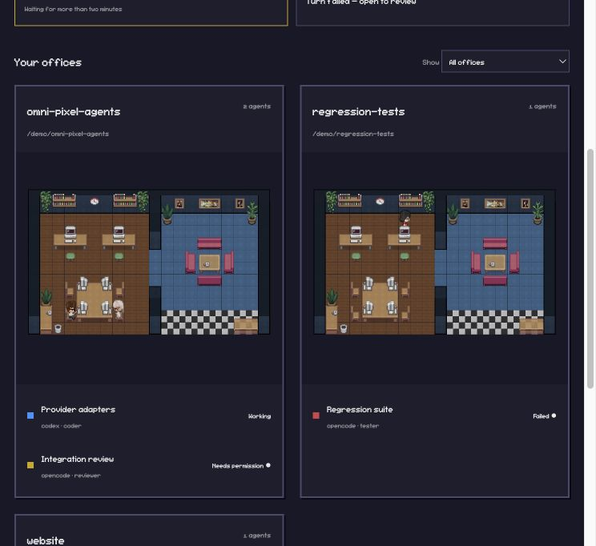
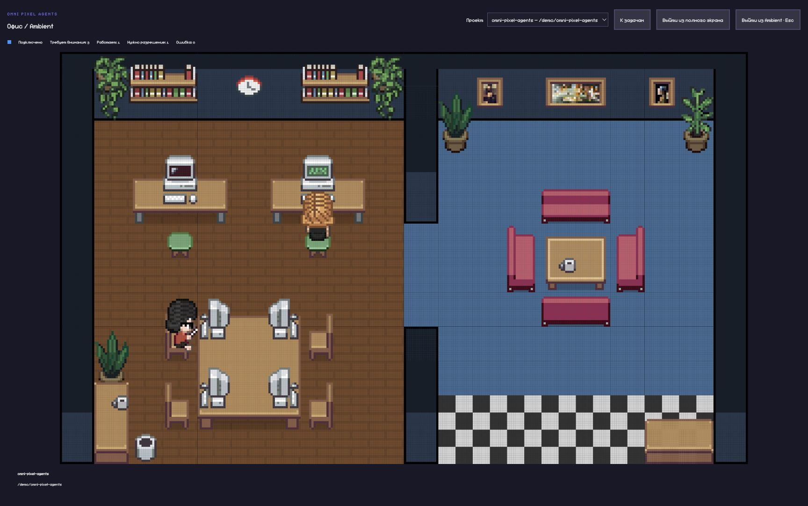
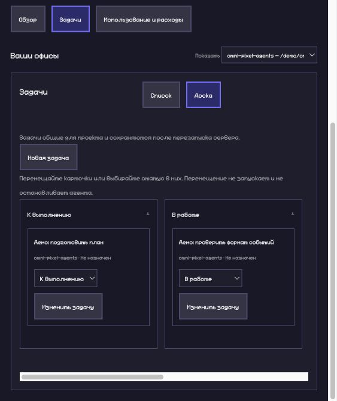
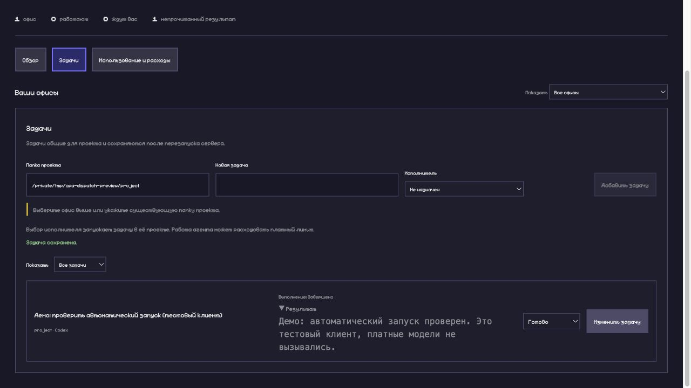
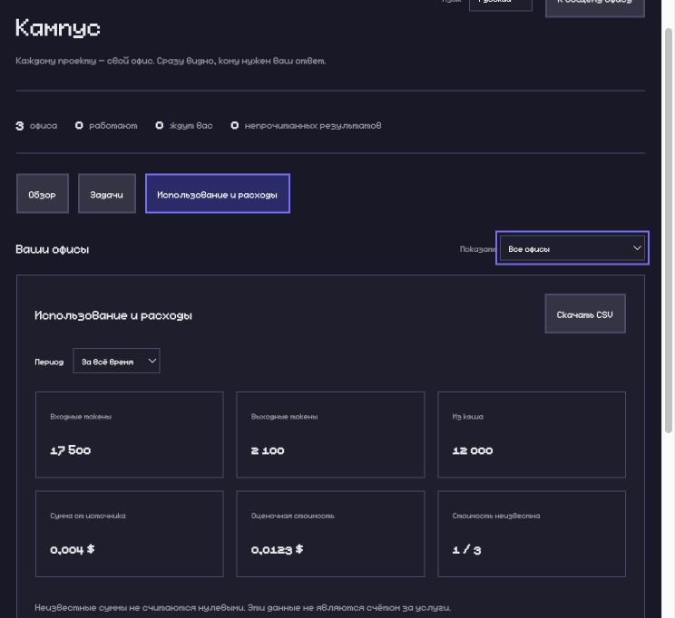

# Omni Pixel Agents

[English](../../README.md) · [Русский](README.ru.md) · [Deutsch](README.de.md) · [Español](README.es.md)

**Ваши кодинг-агенты в одном живом пиксельном офисе.**

Видно, какой проект движется, кому нужен ваш ответ и сколько ресурсов ушло на задачу. Каждый агент сохраняет привычный способ работы.

## С какими агентами работает OPA

| Агент                | Как подключается к OPA                                                                                                                         |
| -------------------- | ---------------------------------------------------------------------------------------------------------------------------------------------- |
| 🤖 **Codex**         | Активность и выполнение задач через `codex exec --json`. Существующие чаты Codex Desktop и интерактивного CLI автоматически не обнаруживаются. |
| 🧩 **OpenCode**      | События в реальном времени через OPA-плагин; выполнение задач через `opencode run --format json`.                                              |
| ✳️ **Claude Code**   | Исходный офис Pixel Agents, hooks/transcripts и прежние кнопки запуска. В списке исполнителей задач OPA его пока нет.                          |
| 🔌 **ACP v1-агенты** | Дополнительный stdio-адаптер с явной настройкой совместимого агента. Запросы, отмена и ответы человека на запросы разрешений.                  |

Установите и авторизуйте выбранный клиент отдельно. В списке исполнителей отображаются запускаемые клиенты на машине с OPA. См. [инструкции подключения](../../docs/opa/GETTING_STARTED.md) и [описание адаптеров](../../docs/opa/ADAPTERS.md).

**Пока в roadmap:** Copilot, Kilo, Gemini, Qwen и Pi — без проверенных встроенных интеграций. Явно настроенная ACP-реализация подключается отдельно; это не автоматическая поддержка любого CLI.



## Что уже работает

- Отдельный офис для каждого проекта, общая визуализация активности Codex и OpenCode.
- Запросы разрешений, ошибки и непрочитанные результаты. На разрешения исходного агента отвечают в его клиенте.
- Наблюдайте за проектом в Office/Ambient с полным экраном и выходом по Escape.
- Ведите задачи списком или канбаном. Перетаскивание и выбор статуса не запускают и не останавливают агента.
- Общий список задач: выберите доступного исполнителя и сохраните новое назначение для запуска. Результат, отмена и явный повтор доступны в карточке.
- Токены, суммы от источника и оценки по проектам и периодам; экспорт CSV. Отсутствующая цена остаётся неизвестной.
- Переключение интерфейса EN/RU. У README также есть немецкая и испанская версии.
- Исходный офис Pixel Agents, редактор и интеграция Claude остаются доступны.

## Попробовать локально

Нужны Node.js 20+ и npm. Установите и авторизуйте выбранный агент отдельно. Откройте управляющую ссылку из вывода сервера; без токена интерфейс доступен только для чтения.

```sh
git clone https://github.com/irodger/omni-pixel-agents.git
cd omni-pixel-agents
npm ci
npm run build
node dist/cli.js --port 3100 --no-terminal
```

`--no-terminal` отключает встроенный терминал; выполнение задач остаётся доступным.

## Перед назначением задачи

Новое непустое назначение запускает агента после сохранения. Название задачи передаётся как запрос в выбранной папке проекта. Используются ваши настройки модели и аккаунт; возможны расходы. Простая смена статуса и повтор журнала ничего не запускают. На проект одновременно выполняется одна задача OPA. После сбоя автоматического возобновления нет.

## Как подключаются агенты

Codex передаёт JSON-поток неинтерактивного запуска, OpenCode — события плагина или JSON запуска задач. Claude использует прежние hooks и transcripts. Слой адаптеров также принимает явно настроенных ACP v1-агентов через stdio. ACP дополняет подключения, а не заменяет их и не делает любой CLI совместимым автоматически.

На запросы разрешений ACP отвечают явно в карточке задачи; разрешения native-агентов остаются в их клиенте.

[Подключение агентов](../../docs/opa/GETTING_STARTED.md) · [Адаптеры и ACP](../../docs/opa/ADAPTERS.md) · [Формат OPA](../../docs/opa/FORMAT.md)

## Скриншоты

Настоящий интерфейс OPA, снятый локально с тестовыми задачами, событиями и синтетическими расходами. Это демонстрация UI, а не платные сессии или счета. На снимках может быть предыдущая версия интерфейса.









## Ранний проект: ограничения

OPA собирается локально из исходников. Публикаций npm/marketplace и облачного сервиса пока нет. JSONL-формат OPA — проект спецификации, а не общепринятый стандарт. Запуски проверены на тестовых клиентах; платный сквозной прогон не заявляется. Интерфейс — EN/RU; DE/ES пока только для README.

## Что остаётся в планах

Отдельные редактируемые планировки; Git worktree с проверяемым слиянием; комната отдыха с достоверным rate limit; проверенные адаптеры Copilot, Kilo, Gemini, Qwen и Pi. Это планы, а не готовые интеграции.

## Документация и разработка

[Проверки](../../docs/opa/VALIDATION.md) · [Исследование](../../docs/opa/RESEARCH.md) · [Документация оригинала](../../README.upstream.md)

```sh
npm run build
npm test
```

## Благодарности

Основано на [Pixel Agents](https://github.com/pixel-agents-hq/pixel-agents) авторства Pablo De Lucca и участников проекта, по [MIT License](../../LICENSE). Исходные сведения об авторах и ресурсах сохранены; см. [ресурсы оригинала](../../README.upstream.md#office-assets). Код и графика из изученных форков не копировались.
